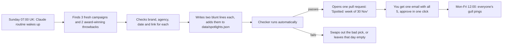

# Automation plan

How Spotted. gets a fresh pick every weekday, without putting an API key inside the extension.

## The short version

A **scheduled Claude routine** runs in the cloud every **Sunday morning** and lines up the whole week: Monday, Wednesday and Friday fresh picks, plus the Tuesday and Thursday throwbacks. You get **one email with all five** and approve them in one click.

**Later, fully automatic:** once you trust the picks, the routine publishes the week straight away and the email becomes a heads-up you can ignore. That's one setting in the prompt (step 9).

## Why this setup

- **No key in the extension.** Extensions are public code, so anything inside one can be read by anyone. The routine runs on Claude's side, so there's nothing to leak.
- **Your laptop can be off.** The routine runs in the cloud on a schedule.
- **One review a week, not five.** All five picks arrive together. Approve them, or ask Claude to swap one.
- **It's checked twice.** Claude checks the facts against the source, then [`scripts/validate.py`](scripts/validate.py) runs before anything is published. It blocks missing fields, two picks on one day, weekend picks, non-throwbacks on Tuesdays and Thursdays, non-https links, minor awards, and anything more than four weeks old.
- **Still fresh.** Friday's pick is found on Sunday, so it's at most a few days older than a same-day pick. The 4-week rule still holds.

## Setup

**Now (done).** Researched and verified picks up to 14 Dec 2026, bundled in the extension and served from GitHub Pages.

**Next: the weekly routine** (`/schedule` in Claude Code, or claude.ai/code → Routines):
- **Schedule:** every Sunday at 07:00 UK time.
- **Repo:** `georgepohl2-design/spotted-daily-ads`, with Claude's GitHub access limited to this one repo.
- **Prompt:** the routine prompt below.
- **Your review:** the routine opens a pull request called `Spotted: week of {Monday's date}`, listing all five picks with their links. GitHub emails you. Press **Merge** if they're fine. If not, comment on the one to swap and Claude fixes it. Merge by Monday 11:00 so Monday's pick goes out at midday.
- **If you don't get round to it:** nothing goes out that week until you merge. Once you switch to automatic, this stops being a risk.

**Ad League updates:** once a month, or when a show announces results, the same routine adds new top prizes to `data/league.json`, using official results pages only. Next up: The One Show, Clios, Effies, Epica, IPA, Kantar, LIA, ADC, Webbys, then Eurobest in December.

## The routine prompt (draft)

> You maintain the Spotted. Chrome extension in this repo. Add next week's five picks (Monday to Friday) to `data/spotlights.json`. Skip any day that already has a pick.
>
> 0. For each day: Monday, Wednesday and Friday are fresh picks (steps 1 to 6). Tuesday and Thursday are throwbacks: so find a major-award winner (Grand Prix, Gold, Silver, Bronze, Pencil, Effie, IPA Effectiveness) from the last 12 months that hasn't run yet, set `throwback: true`, fill in `award` with its `year`, and leave out `campaignDate`. Then skip to step 3.
> 1. Find campaigns launched or first covered in the last 14 days (never more than 28 days before the day it runs) on: The Drum, Adweek, Ad Age, Campaign, LBB, Creative Review, Ads of the World, shots, Contagious, Muse by Clio, Marketing Week, Marketing Dive, B&T. Favour UK, US and European work, but pick anything genuinely interesting from anywhere.
> 2. Skip anything already in `data/spotlights.json`. Don't repeat a brand or agency used in the last 7 days.
> 3. Open the source article and confirm: brand, lead agency, campaign name, and launch or coverage date. If any of these isn't stated in the source, pick something else. Never guess an agency.
> 4. Agency link: only add `agencyUrl` if you've loaded the agency's site and it's clearly theirs. Otherwise use `null`. Add the agency to `data/league.json` → `agencies` if it's new.
> 5. Award: `null` unless the work has officially won a major award: Grand Prix, Titanium, Gold, Silver or Bronze at Cannes Lions, a D&AD Pencil, a One Show Pencil, a Clio, an Effie or an IPA Effectiveness Award. Shortlists and finalists don't count. Then use `{ "prize": "Gold", "show": "Cannes Lions 2026" }`, from the official results.
> 6. Blurb: two short lines in our voice: chill, blunt, a bit can't-be-bothered, about why it's cool. Under 200 characters. Your own words, never article text. Joke about the awards circus or the idea, never about people or an agency's work. Example: "People want to steal KitKats. We get it. They made an ad about it. Fair."
> 7. Run `python3 scripts/validate.py --links`. Fix anything it flags.
> 8. If a pick fails and you can't fix it, swap it for another. If nothing passes for a day, leave that day empty.
> 9. Open one pull request titled `Spotted: week of {Monday's date}`. In the description, list each day: brand, agency, campaign, source link, and one line on why you picked it. Don't merge it yourself. (Fully automatic later: commit straight to `main` instead and open the same list as an issue, so the owner still gets the email.)

## Option B: a GitHub Action instead of a Claude routine

If you'd rather not use a routine, a GitHub Action can run the same steps on a schedule by calling the Claude API.
- The API key lives only as a **GitHub secret** (Settings → Secrets → Actions), never in the code.
- It costs a few pence per run in API usage, billed separately from a Claude subscription.
- It's more setup and more moving parts, so the routine is the better start.

## Things to keep an eye on

- **Paywalls.** Prefer free-to-read sources for "Read more" (The Drum, B&T, Creative Review, Marketing Dive). Ad Age and some Adweek pieces are paywalled.
- **Thin weeks.** Late December is quiet. If nothing fresh passes the checks, the routine should skip the day. The extension then shows the last pick while it's still under four weeks old, and after that "Nothing today. The gull's on a break."
- **Corrections.** If a fact turns out wrong, edit the entry in `data/spotlights.json`. Every extension picks up the fix on the next refresh.
