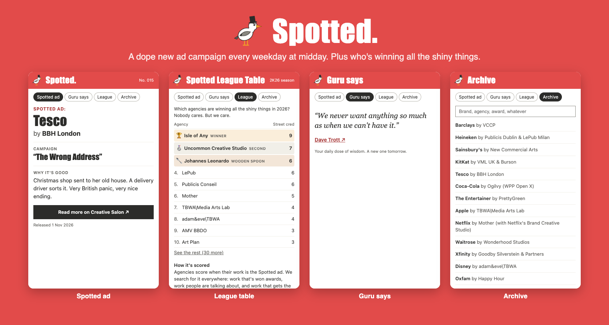
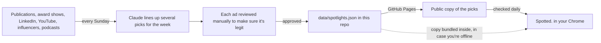

# Spotted.



**A dope new ad campaign revealed every weekday at midday, right in your Chrome toolbar.**

- **Monday, Wednesday and Friday:** a recent campaign, launched in the last few weeks.
- **Throwback Tuesday and Throwback Thursday:** a campaign from the last year that won something big. Not new. Still slaps.
- **Weekends off.** Open it on a Saturday and the gull tells you to go outside.

If you're in marketing or advertising and you like ads, give it a follow. Or don't. We don't care.

---

## The problem

The good campaigns are spread all over the place: publications, award shows, LinkedIn, YouTube, influencers, podcasts.

Most people see one, think "nice", and never save it. Pulling them all together into one place? Who can be bothered.

**Spotted. can be bothered.** One good recent campaign, pushed to you every weekday at midday. No hunting for it, and none of the crap that usually comes with it.

## Four sections

Click the seagull on your Chrome toolbar and you get:

### 1. The Spotted ad

- **The brand**, big.
- **Who made it:** the agency, or the brand's in-house team.
- **The campaign name.**
- **Why it's good**, in two blunt lines.
- **A link** to learn more on a free-to-read site.

Plus:
- **A little blue "1"** on the icon when there's a new ad you haven't seen, like an unread message.
- **A midday ping:** a notification at 12:00 on weekdays with the brand and who made it. A setup page on install checks it actually shows up on your computer.
- **Don't poke the gull.** Hover over it and it glares at you. Click it and it squawks.
- **Nothing stale.** Monday, Wednesday and Friday picks are never more than four weeks old. Tuesday and Thursday are throwbacks, so they're allowed to be.

### 2. The Spotted League Table (2K26 season)

Which agencies are winning all the shiny things. Nobody cares. But we care. First place is King of all agencies, second is the First loser, third gets the wooden spoon.

Agencies score a point every time their work is Spotted (2 or 3 if it's super special). Everyone started with points for 2026's top prizes, from official results only. In-house teams are left out. The joke is on the awards circus, not on anyone's work.

### 3. Guru says

Your daily dose of wisdom: one checked quote a day from an ad legend, CMO or founder.

### 4. Archive

Every past pick, searchable.

**Prefer a feed reader?** Every pick that has run is in the [Spotted. feed](https://georgepohl2-design.github.io/spotted-daily-ads/feed.xml).

**No tracking, no accounts, no API keys** inside the extension. It reads a public list of picks, and every pick is checked by hand before it goes in.

## Install it (no coding needed, about 2 minutes)

It's in **beta** and not on the Chrome Web Store yet, so you load it yourself. It's easier than it sounds.

1. **Download it.** On this page, click the green **Code** button, then **Download ZIP**.
2. **Unzip it.** Double-click the downloaded file. You'll get a folder called `spotted-daily-ads-main`.
3. **Open Chrome's extensions page.** Type `chrome://extensions` in the address bar and press Enter.
4. **Turn on Developer mode.** It's the switch in the top-right corner.
5. **Click "Load unpacked"** (top left) and choose the `spotted-daily-ads-main` folder.
6. **Pin the gull.** Click the puzzle-piece icon next to the address bar, then the pin next to **Spotted.**
7. **Click the gull.** That's today's pick.

To update later, download the ZIP again, replace the folder, and press the ↻ refresh icon on the Spotted. card in `chrome://extensions`. New daily picks arrive on their own; you only need to update for new features.

## How it works



1. **Every Sunday, a scheduled Claude routine lines up the next week's picks to review:** three fresh campaigns and two throwbacks.
2. **Each ad is reviewed manually to make sure it's legit.** The brand, the agency, the campaign name and the date all have to be confirmed in the source, and the link has to work.
3. **An automatic [checker](scripts/validate.py) runs too.** It blocks missing facts, insecure links, two picks on one day, weekend picks, minor awards, and anything more than four weeks old.
4. **Once approved, the week goes live.** Every installed copy of Spotted. picks it up from GitHub Pages, and falls back to the copy bundled inside if you're offline.

The details are in [AUTOMATION.md](AUTOMATION.md).

## What makes the cut

- **The whole idea, not just ads:** films, stunts, brand activations, gaming activations, brand collabs, cool growth ideas. Anything that's helping a brand grow.
- **Fresh:** launched or first covered in the last few weeks. Never older than four.
- **Throwbacks:** won a major creative or effectiveness award in the last year.
- **Global, leaning UK, US and Europe.** Anything genuinely interesting from anywhere gets in.
- **Agency or in-house, always named.** If no source says who made it, the card says "No agency found". We never guess.
- **Our words:** the two lines are written fresh, never copied from an article.
- **Award badge only for the big ones:** a Grand Prix, Titanium, Gold, Silver or Bronze at Cannes Lions, a D&AD Pencil, a One Show Pencil, a Clio, an Effie or an IPA Effectiveness Award. Shortlists and finalists don't count.

## What's in this repo

```
manifest.json        Chrome extension settings (Manifest V3)
popup.html/.css/.js  The popup you see
background.js        The midday nudge and the blue "1" for a new pick
welcome.html         The setup page that opens on install: test the midday alert
lib/                 Shared code: loading data, dates, league table maths
data/                The picks, quotes and league table (this is what the weekly job updates)
icons/               The gull, at Chrome's icon sizes
scripts/validate.py  The data checker
scripts/build_feed.py Builds feed.xml, the RSS feed of picks that have run (for email and feed readers)
social/              Instagram and LinkedIn posts: image template, caption maker, handles to tag
docs/                README cover, store screenshots and listing text
DESIGN.md            Design decisions: name, look, voice, screens
AUTOMATION.md        The plan for the weekly picks
PRIVACY.md           Privacy policy (it collects nothing)
```

## Licence

All rights reserved, see [LICENSE](LICENSE).
