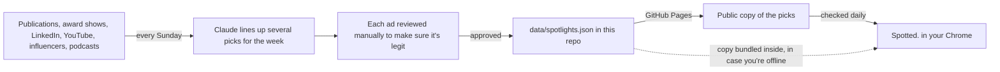

# Spotted.


**A dope new ad campaign revealed every weekday at midday, right in your Chrome toolbar.**

- **Monday, Wednesday and Friday:** a recent campaign, launched in the last few weeks.
- **Throwback Tuesday and Throwback Thursday:** a campaign from the last year that won something big. Not new. Still slaps.
- **Weekends off.** Open it on a Saturday and the gull tells you to go outside.

If you're in marketing or advertising and you like ads, give it a follow. Or don't. We don't care.

---

## The problem

Good marketers keep a swipe file: a folder of ads they wish they'd made. I've kept one for years.

But keeping up is a faff. The good stuff is spread across publications, award shows, LinkedIn, YouTube, influencers and podcasts. Most days you either doom-scroll the lot or miss the work everyone's talking about.

**Spotted. is a swipe file that fills itself.** We go through all of it, review it, and bring you one a day: two lines on why it's good, and a link to see more.

## The Spotted ad

Click the seagull in your Chrome toolbar and you get the day's ad:

- **The brand**, big.
- **Who made it:** the agency, or the brand's in-house team.
- **The campaign name**, with a yellow badge only if it's won a major award.
- **Why it's good**, in two blunt lines.
- **A link** to read more on a free-to-read site.

Plus:
- **A yellow dot** on the icon when there's a new ad you haven't seen.
- **A midday ping:** a notification at 12:00 on weekdays, like "Tesco by BBH London".
- **Don't poke the gull.** Hover over it and it glares at you. Click it and it squawks.
- **Nothing stale.** A fresh pick is never shown more than four weeks after the campaign launched.

**No tracking, no accounts, no API keys** inside the extension. It reads a public list of picks and that's it.

## Install it (no coding needed, about 2 minutes)

It's not on the Chrome Web Store yet, so you load it yourself. It's easier than it sounds.

1. **Download it.** On this page, click the green **Code** button, then **Download ZIP**.
2. **Unzip it.** Double-click the downloaded file. You'll get a folder called `spotted-daily-ads-main`.
3. **Open Chrome's extensions page.** Type `chrome://extensions` in the address bar and press Enter.
4. **Turn on Developer mode.** It's the switch in the top-right corner.
5. **Click "Load unpacked"** (top left) and choose the `spotted-daily-ads-main` folder.
6. **Pin the gull.** Click the puzzle-piece icon next to the address bar, then the pin next to **Spotted.**
7. **Click the gull.** That's today's pick.

To update later, download the ZIP again, replace the folder, and press the ↻ refresh icon on the Spotted. card in `chrome://extensions`. New daily picks arrive on their own; you only need to update for new features.

## How it works



1. **Every Sunday, a scheduled Claude routine lines up the next week's picks to review:** three fresh campaigns and two throwbacks.
2. **Each ad is reviewed manually to make sure it's legit.** The brand, the agency, the campaign name and the date all have to be confirmed in the source, and the link has to work.
3. **An automatic [checker](scripts/validate.py) runs too.** It blocks missing facts, insecure links, two picks on one day, weekend picks, minor awards, and anything more than four weeks old.
4. **Once approved, the week goes live.** Every installed copy of Spotted. picks it up from GitHub Pages, and falls back to the copy bundled inside if you're offline.

The details are in [AUTOMATION.md](AUTOMATION.md).

## What makes the cut

- **Fresh:** launched or first covered in the last few weeks. Never older than four.
- **Throwbacks:** won a major creative or effectiveness award in the last year.
- **Global, leaning UK, US and Europe.** Anything genuinely interesting from anywhere gets in.
- **Agency or in-house, always named.** If no source says who made it, it doesn't go in. We never guess.
- **Our words:** the two lines are written fresh, never copied from an article.
- **Award badge only for the big ones:** a Grand Prix, Titanium, Gold, Silver or Bronze at Cannes Lions, a D&AD Pencil, a One Show Pencil, a Clio, an Effie or an IPA Effectiveness Award. Shortlists and finalists don't count.

## The Spotted League Table (2K26 season)

A cheeky league table of which agencies are winning all the shiny things. Nobody cares. But we care. First place gets a trophy, second a medal, third the wooden spoon.

**How it's scored:**
- **It's scored off the Spotted ad.** Agencies score when their work is picked.
- **We search for it everywhere:** work that's won awards, work people are talking about, and work that gets the credit.
- **One point each time an agency is spotted.** If the work is super special, it can get 2 or 3.
- **Ties go to whoever was spotted most recently.**
- **The tally has only just begun.** To kick things off, every agency starts with 3 points for each of 2026's top prizes: the Cannes Lions Grands Prix (including Creative Effectiveness), D&AD Black Pencils, the IPA Effectiveness Grand Prix and the UK Grand Effie. Every win is from official results.
- **Agencies only.** In-house brand teams are left out.
- **Credit goes to the agency or office named in the source**, so De La Cruz Ogilvy (Puerto Rico) counts separately from other Ogilvy offices.
- The season started on 2 November 2026. The joke is on the awards circus, not on anyone's work.

## Also in the popup

**Guru says** (your daily dose of wisdom: one checked quote a day from an ad legend, CMO or founder) and the **Archive** (every past pick, searchable).

## Worth following

Not pulled in automatically, but you should listen or follow anyway:
- [Breaking & Entering Media](https://www.linkedin.com/company/breaking-entering-media/posts/): fast, fun ad and marketing news on LinkedIn, YouTube, their [newsletter](https://breakingandentering.beehiiv.com) and podcast. One of our key sources.
- **Uncensored CMO** (podcast)
- **HUNGRY.** with Dan Pope (podcast on challenger food and drink brands)
- **On Strategy Showcase** with Fergus O'Carroll (podcast: the strategy behind great campaigns)

## What's in this repo

```
manifest.json        Chrome extension settings (Manifest V3)
popup.html/.css/.js  The popup you see
background.js        The midday nudge and the yellow dot
lib/                 Shared code: loading data, dates, league table maths
data/                The picks, quotes and league table (this is what the weekly job updates)
icons/               The gull, at Chrome's icon sizes
scripts/validate.py  The data checker
docs/                README cover, store screenshots and listing text
DESIGN.md            Design decisions: name, look, voice, screens
AUTOMATION.md        The plan for the weekly picks
PRIVACY.md           Privacy policy (it collects nothing)
```

## Built by

[@georgepohl2-design](https://github.com/georgepohl2-design), a growth marketer building simple AI tools for marketers, each doing one job well. Built with [Claude Code](https://claude.com/claude-code).

Campaign facts belong to the brands and agencies, and the source articles belong to their publishers. Spotted. just points at the good stuff.

## Licence

All rights reserved, see [LICENSE](LICENSE). Have a look around and install it for yourself, but please don't copy or republish it.
