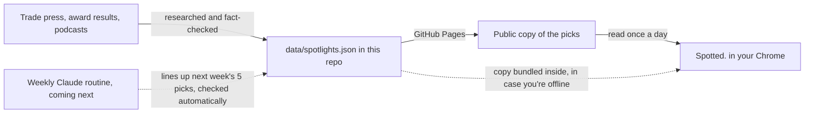

# Spotted.


**A dope new ad campaign every day at midday, in a Chrome extension. Plus the Ad League: a cheeky league table of which agencies are actually winning all the shiny things.**

Who's winning all the shiny things? Silly, but we care.

---

## The problem

Good marketers keep a swipe file: a folder of ads they wish they'd made. I've kept one for years.

But keeping up is a faff. The good stuff is spread across The Drum, Adweek, Ad Age, Campaign, LBB, Creative Review and a dozen podcasts and LinkedIn feeds. Most days you either doom-scroll trade press or miss the work everyone's talking about.

**Spotted. is a swipe file that fills itself.** One campaign a day, picked for you, in two lines, with a link to read more.

## What it does

Click the seagull in your Chrome toolbar and you get four tabs:

| Tab | What you get |
|---|---|
| **Spotlight** | One campaign: **brand**, agency (linked), campaign name, an award badge only if it won a major award, two blunt lines on why it's good, and a link to the source article. |
| **Guru says** | A line from an ad legend: Rory Sutherland, David Ogilvy, Leo Burnett, Dave Trott, Scott Galloway. Every quote is checked against a real source. |
| **Ad League** | The 2K26 season agency league table, ranked by *street cred*. |
| **Archive** | Every past pick. Search by brand, agency, award or anything else. |

Plus:
- **A yellow dot** on the icon when there's a new pick you haven't seen.
- **A midday nudge**: a Chrome notification at 12:00 ("Disney by adam&eve\\TBWA") when the new campaign lands.
- **Throwback Tuesday and Throwback Thursday.** Two days a week it's a major-award winner from the last year instead of something new. Labelled "Throwback Thursday: still slaps".
- **Weekends off.** No pings on Saturday or Sunday. Open it anyway and the gull tells you to go outside.
- **Nothing stale.** A pick is never shown more than four weeks after the campaign launched or was covered. If there's nothing fresh, the gull goes on a break.

**No tracking, no accounts, no API keys** inside the extension. It reads a public list of picks and that's it.

## Install it (no coding needed, about 2 minutes)

It's not on the Chrome Web Store yet, so you load it yourself. It's easier than it sounds.

1. **Download it.** On this page, click the green **Code** button, then **Download ZIP**.
2. **Unzip it.** Double-click the downloaded file. You'll get a folder called `spotted-daily-ads-main`.
3. **Open Chrome's extensions page.** Type `chrome://extensions` in the address bar and press Enter.
4. **Turn on Developer mode.** It's the switch in the top-right corner.
5. **Click "Load unpacked"** (top left) and choose the `spotted-daily-ads-main` folder.
6. **Pin the gull.** Click the puzzle-piece icon next to the address bar, then the pin next to **Spotted.**
7. **Click the gull.** That's today's pick.

To update later, download the ZIP again, replace the folder, and press the ↻ refresh icon on the Spotted. card in `chrome://extensions`. New daily picks arrive on their own; you only need to update for new features.

## How it works



- All the picks live in [`data/spotlights.json`](data/spotlights.json). One entry per day.
- The extension reads the latest copy from GitHub Pages, and falls back to the copy bundled inside it if you're offline.
- A [checker](scripts/validate.py) runs on every change and blocks anything broken: missing facts, a link that isn't secure, two picks on one day, or a campaign more than four weeks old.
- New picks will be lined up each week by a scheduled Claude routine. See [AUTOMATION.md](AUTOMATION.md).

## How a campaign gets picked

- **Fresh:** launched or covered in the last two to four weeks. Never older than four.
- **Global, with a lean towards the UK, US and Europe.** Anything genuinely interesting from anywhere gets in.
- **Fact-checked:** brand, agency, campaign name and date are all confirmed in the source article before it goes in. The source link has to work.
- **Our words:** the two lines are written fresh. No copying article text.
- **Award badge only for the big ones.** A yellow badge shows up only for a major award: a Grand Prix, Titanium, Gold, Silver or Bronze at Cannes Lions, a D&AD Pencil, a One Show Pencil, a Clio, an Effie or an IPA Effectiveness Award. Shortlists and finalists don't count. No major award, no badge. Most big shows run in the first half of the year, so plenty of great November work has no badge yet.

## The Ad League (2K26 season)

The popup only says *"How we score? I bet you'd like to know."* Here's the boring version:

| What | Street cred |
|---|---|
| A top prize at a counted show (Cannes Lions Grand Prix or Titanium, D&AD Black Pencil) | **10** |
| Being featured in Spotted. | **3** each time |

- **Counted so far:** Cannes Lions 2026 and D&AD 2026.
- **Not yet counted:** The One Show, Clios, Effies, Epica, IPA Effectiveness, Kantar Creative Effectiveness, LIA, ADC, Webbys and Eurobest (December). These get added as each show's results are tallied.
- Credit goes to the lead agency named in the official results.
- **No predicted or made-up wins, ever.** Every win in [`data/league.json`](data/league.json) is from the official 2026 results, cross-checked against [Creative Review's Cannes write-up](https://www.creativereview.co.uk/cannes-lions-2026-all-the-grand-prix-winners/) and [Adweek's D&AD write-up](https://www.adweek.com/creativity/these-are-the-4-black-pencil-winners-of-the-2026-dad-awards/).
- The joke is on the awards circus, not on anyone's work. For the grown-up version, see the [WARC Rankings](https://www.warc.com/en/data-benchmarks/rankings).

## Where the picks come from

**Trade press:** The Drum, Adweek, Ad Age, Campaign, LBB (Little Black Book), Creative Review, Ads of the World, shots, Contagious, Muse by Clio, Marketing Week, Marketing Dive, B&T.

**Award shows:** Cannes Lions, D&AD, The One Show, Clio Awards, Effie Worldwide, Epica, Kantar Creative Effectiveness, IPA Effectiveness Awards, LIA, ADC, Webby Awards, Eurobest, Spikes Asia, Dubai Lynx, The Drum Awards, plus WARC for effectiveness data. (Interbrand is brand valuation rather than campaign awards, so it's context only.)

**Worth following** (they can't be pulled in automatically, but you should listen or follow anyway):
- [Breaking & Entering Media](https://www.linkedin.com/company/breaking-entering-media/posts/) on LinkedIn
- **Uncensored CMO** (podcast)
- **HUNGRY.** with Dan Pope (podcast on challenger food and drink brands)
- **On Strategy Showcase** with Fergus O'Carroll (podcast: the strategy behind great campaigns)

## What's in this repo

```
manifest.json        Chrome extension settings (Manifest V3)
popup.html/.css/.js  The popup you see
background.js        The midday nudge and the yellow dot
lib/                 Shared code: loading data, dates, street cred maths
data/                The picks, quotes and league table (this is what the daily job updates)
icons/               The gull, at Chrome's icon sizes
scripts/validate.py  The data checker
docs/                README images
DESIGN.md            Design decisions: name, look, voice, screens
AUTOMATION.md        The plan for daily automatic picks
```

## Built by

[@georgepohl2-design](https://github.com/georgepohl2-design), a growth marketer building simple AI tools for marketers, each doing one job well. Built with [Claude Code](https://claude.com/claude-code).

Campaign facts belong to the brands and agencies, and the source articles belong to their publishers. Spotted. just points at the good stuff.

## Licence

All rights reserved, see [LICENSE](LICENSE). Have a look around and install it for yourself, but please don't copy or republish it.
